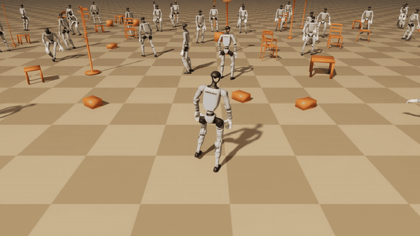
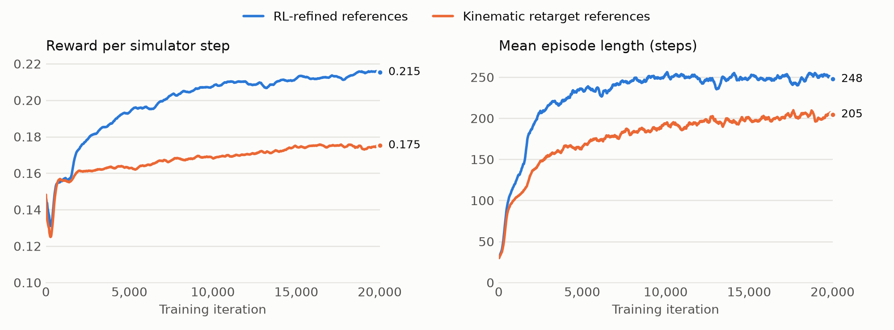

# supermimic_hoi_vibed



A minimal working recipe for whole-body human-object interaction on the **Unitree G1 (29 DoF)
with two Inspire hands**. One policy tracks **45 reference clips** (five for each of nine objects)
from [Weave](https://xiaohu-art.github.io/Weave/), moving the objects through contact alone.

It is trained with a learned world model of the robot and the object and with differentiable
actor rollouts inside that model: the [SuperMimic](https://arxiv.org/abs/2610.28480) approach,
extended to objects. Physics is MuJoCo-Warp through mjlab.

**No generalization.** The policy is trained and evaluated on the same 45 clips. Nothing here
shows that it handles unseen motions or objects.

## Results

One training run of `configs/weave45.json` per reference type (seed 0, 20,000 iterations), each
evaluated three times on its 45 training clips. A clip is **completed** when the episode reaches
its last frame, and a **success** when in addition the object stayed within 0.2 m and 0.8 rad of
its reference, covered at least half of the reference object's path, and was lifted if the
reference lifts it. The counts are the three evaluations.

| References | Success | Completion |
|---|---|---|
| RL-refined | **94.1 %** (43, 42, 42 / 45) | 95.6 % (43, 43, 43 / 45) |
| Kinematic retarget | 72.6 % (32, 33, 33 / 45) | 85.9 % (38, 39, 39 / 45) |

- **Kinematic retarget references** are Weave's retargeted motions (`reference/`): inverse
  kinematics with a contact-aware hand refinement, never simulated.
- **RL-refined references** are the same clips as Weave's RL tracking policy executed them in
  simulation (`rollout/`).

**Reference quality matters:** with the same code, clips and settings, the refined references
raise the success rate from 73 % to 94 %.




Each run took about 2 h 30 min on one NVIDIA 4090 (0.40 s per iteration, 21.1 GiB of device
memory). With the RL-refined references the success rate was already 95.6 % after 10,000
iterations.

## Setup

Python 3.12 and a CUDA GPU with 24 GB (the recipe uses 19 to 21 GiB). Versions are pinned in
`uv.lock`.

```bash
uv sync --all-extras
```

Assets and references are built from a [Weave](https://github.com/xiaohu-art/Weave) checkout and
Weave's motion data, the [`appolyn/Weave`](https://huggingface.co/datasets/appolyn/Weave) dataset
on Hugging Face:

- RL-refined references: [`rollout/test`](https://huggingface.co/datasets/appolyn/Weave/tree/main/rollout/test)
  (9 files, 1.9 GB), placed in the checkout's `data/rollout/test/`.
- Kinematic retarget references, optional: [`reference/test`](https://huggingface.co/datasets/appolyn/Weave/tree/main/reference/test)
  (9 files, 1.8 GB), placed in the checkout's `data/test/`.

```bash
uv run python -m supermimic_hoi.prepare --weave /path/to/Weave --split rollout/test
```

This writes the robot model, the object collision assets and 600 reference clips to `data/`
(git-ignored). The recipe trains on 45 of them, listed in `configs/weave45_clips.txt`; in Weave's
rollout archives the same names carry the suffix `__policy_rollout`.

For the kinematic retarget references, run `prepare` without `--split`; this replaces
`data/weave600`. They train worse; see Results.

## Usage

```bash
# Train: 45 clips, 1,800 worlds, 20,000 iterations
uv run python -m supermimic_hoi.train --config configs/weave45.json

# Evaluate: completion and success rate per object
uv run python -m supermimic_hoi.evaluate logs/weave45/last.pt

# Record one clip and render it next to its reference
uv run python -m supermimic_hoi.evaluate logs/weave45/last.pt --record sub17_smallbox_005_v01
uv run python -m supermimic_hoi.render --rollout results/evaluation_sub17_smallbox_005_v01.npz --output results/rollout.mp4

# Tests
uv run pytest
```

## Attribution

- [SuperMimic](https://arxiv.org/abs/2610.28480): the original method. Q. Liao, Y. Shao, J. Long,
  K. Zakka, R. Horowitz, P. Abbeel, K. Sreenath, "SuperMimic: Scaling Humanoid Whole-Body Control
  with One Differentiable World Model", arXiv:2610.28480, 2026.
- [supermimic_vibed](https://github.com/zita-ch/supermimic_vibed): the unofficial SuperMimic
  reimplementation this line of code started from.
- [BlinkMimic](https://github.com/fuyichen0725/blinkmimic): the fast motion-tracking recipe built
  on supermimic_vibed. This repository is a port of its HOI variant (coupled robot/object world
  model, learned contact reward) to the G1 with Inspire hands.
- [Weave](https://github.com/xiaohu-art/Weave): the G1 + Inspire model, the objects and the
  reference motions. `src/supermimic_hoi/prepare/weave_hulls.npz` holds collision hulls derived
  from Weave's object assets.
- [mjlab](https://github.com/mujocolab/mjlab), [MuJoCo](https://github.com/google-deepmind/mujoco)
  and [MuJoCo Warp](https://github.com/google-deepmind/mujoco_warp): simulation.

## License

The code is released under the [MIT License](LICENSE).
